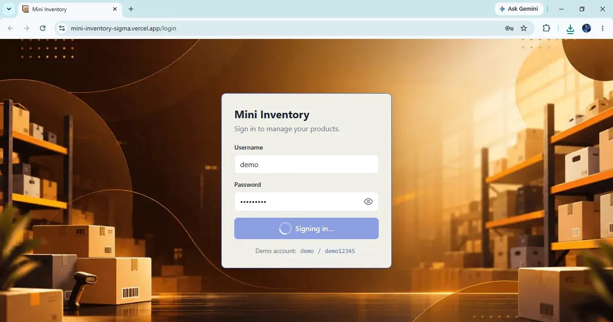
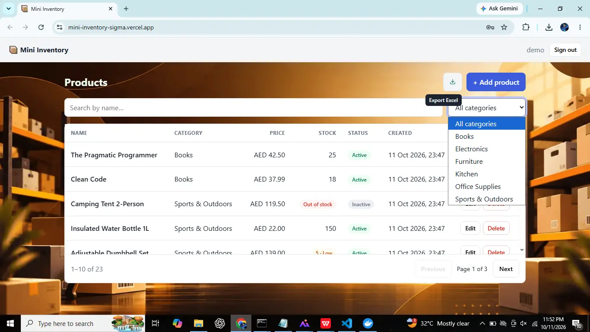
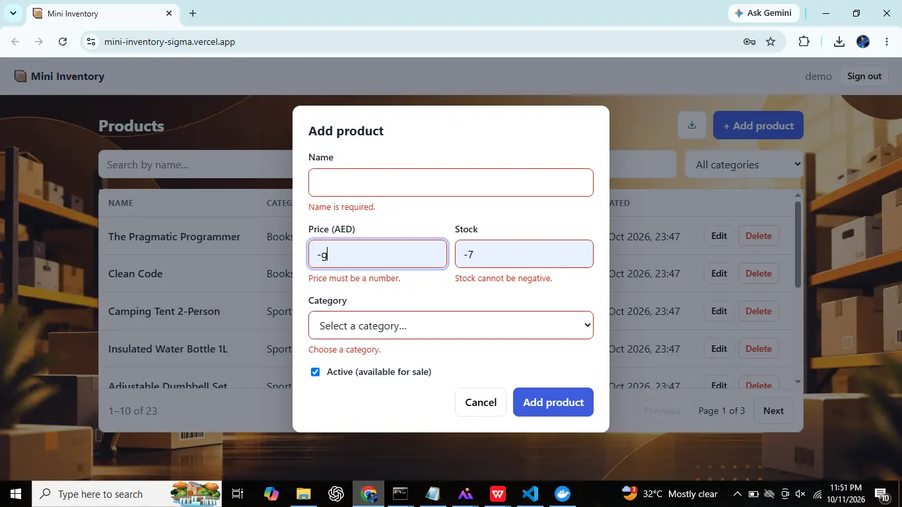
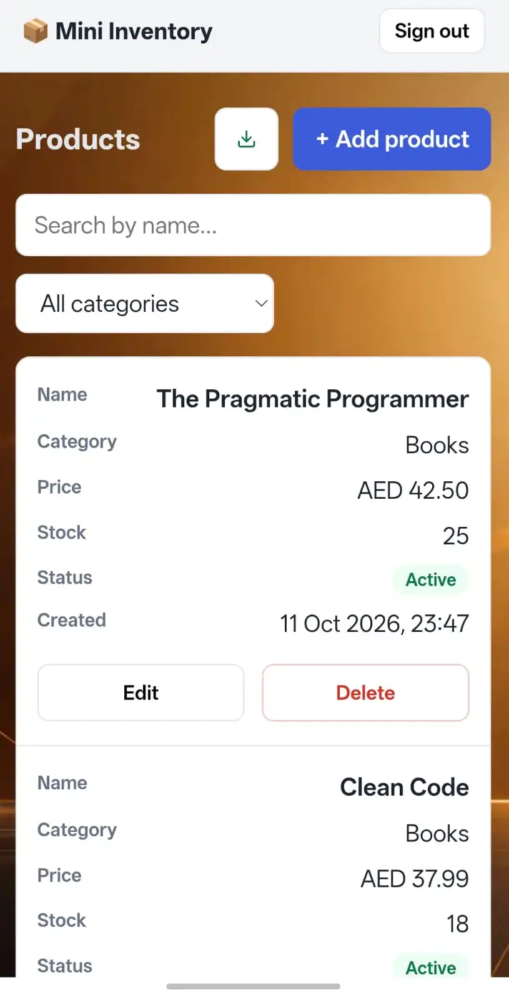

# Mini Inventory System

**Live demo:** https://mini-inventory-sigma.vercel.app (login: `demo` / `demo12345`)
The API runs on Render's free tier, so the first request may take about a minute to wake up. Data resets on restart.
| Login | Products |
|-------|----------|
|  |  |

| Add /Update product (Mobile View)| Product (Mobile View) |
|-------------|--------|
|  |  |
A small inventory manager: **Django REST Framework** API + **React (TypeScript)** SPA.

- Products CRUD with pagination, category filter and debounced name search
- JWT authentication, with a show/hide password toggle on the login page
- Validation on both sides, with server errors mapped back onto the form fields
- Loading / error / empty states everywhere, plus a global loading bar for any API activity
- Responsive layout (table on desktop, cards on mobile)
- Prices shown in AED and dates shown in UAE time (Asia/Dubai)
- Excel export of the filtered product list (client-side, `exceljs`)
- Bonus: Docker Compose, backend tests (pytest), frontend tests (Vitest + React Testing Library), TanStack Query, GitHub Actions CI, live deployment

## Test login

| Username | Password    |
|----------|-------------|
| `demo`   | `demo12345` |

Created by the `seed` command (23 products across 6 categories). The credentials are also shown on the login page.

---

## Run it

### Option A: Docker Compose (everything, one command)
Verified on Windows 10 with Docker Desktop (Postgres 16, Django/gunicorn, nginx).
```bash
docker compose up --build
```

- App: http://localhost:8080
- API: http://localhost:8000/api/ · Django admin: http://localhost:8000/admin/

The backend container runs migrations and seeds demo data on start (disable with `SEED_ON_START=0`).

### Option B: local development

**Backend** (Python 3.12, uses SQLite, no other setup):

```bash
cd backend
python -m venv .venv && source .venv/bin/activate    # Windows: .venv\Scripts\activate
pip install -r requirements-dev.txt
python manage.py migrate
python manage.py seed            # demo data + demo user (use --reset to wipe first)
python manage.py runserver       # http://localhost:8000
```

**Frontend** (Node 22+):

```bash
cd frontend
npm install
npm run dev                      # http://localhost:5173
```

In dev, Vite proxies `/api` to `localhost:8000`, so there is no CORS configuration to fiddle with.

> The frontend test tooling (Vitest + jsdom) needs a recent Node. On older versions, `npm test` fails with `webidl.util.markAsUncloneable is not a function`.

### Tests

```bash
cd backend  && pytest            # 25 tests
cd frontend && npm test          # 35 tests
cd frontend && npm run typecheck
```

---

## Deployment

- **Frontend:** Vercel (static build of the Vite app), redeployed on every push to `main`.
- **API:** Render free tier. It sleeps when idle, which is why the first request can be slow.

---

## API

All endpoints except login require `Authorization: Bearer <access token>`.

| Method | Endpoint | Notes |
|---|---|---|
| POST | `/api/auth/token/` | `{username, password}` → `{access, refresh}` (rate-limited, 10/min per IP) |
| POST | `/api/auth/token/refresh/` | `{refresh}` → `{access}` |
| GET | `/api/categories/` | Read-only, unpaginated (feeds dropdowns) |
| GET | `/api/products/` | `?page=`, `?page_size=` (max 100), `?category=<id>`, `?search=<name>`, `?is_active=`, `?ordering=price,-created_at` |
| POST | `/api/products/` | Create |
| GET / PUT / PATCH / DELETE | `/api/products/<id>/` | |

Validation errors come back as `400` with DRF's standard shape: `{"price": ["Price must be greater than 0."]}`.

## Project layout

```
backend/
  config/            settings (env-driven), urls
  inventory/         models, serializers, viewsets, filters, pagination, seed command
  inventory/tests/   pytest suite
frontend/src/
  api/               axios client (+ token refresh), endpoint functions
  auth/              AuthContext, ProtectedRoute
  components/        ProductTable, ProductForm, Modal, ConfirmDialog, Pagination, LoadingBar, States
  hooks/             useDebounce, TanStack Query hooks
  lib/               validation (zod), error parsing, formatting (AED, UAE time), Excel export
  pages/             LoginPage, ProductsPage
docker-compose.yml   db (Postgres) + backend (gunicorn) + frontend (nginx)
```

---

## Key technical decisions

**Backend**
- **JWT via `simplejwt`.** Stateless, works naturally with a separate SPA, and gives access/refresh tokens out of the box. Access tokens last 30 min, refresh tokens 1 day. Login is throttled to slow down password guessing.
- **Validation in the serializer *and* the DB.** `validate_price` / `validate_stock` give friendly messages; a `CHECK (price > 0)` constraint and `PositiveIntegerField` protect the data if anything bypasses the API (admin, shell, scripts).
- **`select_related("category")`** on the queryset so `category_name` doesn't cause an N+1 query per row.
- **`on_delete=PROTECT`** for the category FK: silently cascading away products when a category is deleted seemed more dangerous than refusing.
- **Prices are `DecimalField`** (serialised as strings), never floats.
- **Page size capped at 100** so a client can't ask for the whole table.
- **Categories are read-only** over the API since the spec only asks for product CRUD; they're managed via admin/seed.
- **Seed as a management command** (idempotent via `update_or_create`) rather than a JSON fixture: it also creates the demo user with a properly hashed password, and is safe to run on every container start.
- **SQLite by default, Postgres when `POSTGRES_DB` is set**, so local setup is zero-config while Compose runs something production-like.

**Frontend**
- **TanStack Query** for server state: caching, request de-duplication, and `keepPreviousData` so the table doesn't flash a spinner while paging or typing. Mutations invalidate the `["products"]` key.
- **Global loading bar** driven by TanStack Query's `useIsFetching` / `useIsMutating`, so every load, page change, search and save shows progress without touching each request.
- **Debounce in a small `useDebounce` hook** (400 ms). The input is controlled and instant; only the debounced value feeds the query key. Changing search or category resets to page 1.
- **react-hook-form + zod** for the form. Price/stock stay strings in the form (instead of `type="number"`) so *I* control the error messages and avoid browser quirks, and convert to numbers only when building the payload.
- **Server errors are mapped back onto the fields** (`setError`), so rules enforced only by the API still show up inline.
- **Axios interceptor with single-flight token refresh**: on a 401 it refreshes once, retries the request, and if refresh fails it logs the user out. Concurrent 401s share one refresh call.
- **Responsive without duplicate markup**: one semantic `<table>` that CSS turns into cards below 720px, using `data-label` for captions.
- **Small hand-written `Modal`** (focus trap, Esc, focus restore, `role="dialog"`/`alertdialog`) instead of a UI-kit dependency, to keep the bundle small.
- **Currency and time via `Intl`.** Prices use `Intl.NumberFormat` with AED, and dates use `Intl.DateTimeFormat` fixed to `Asia/Dubai`, so every viewer sees the same values. Only the display changes; the API still stores plain decimals and UTC timestamps.
- **Client-side Excel export.** The button fetches every page of the current filtered result (same search and category as the table, 100 rows per request), builds an `.xlsx` in the browser with `exceljs`, and downloads it. It needs no backend change, reuses the authenticated axios client, and the library is loaded only when the button is clicked so it doesn't add to the initial bundle.
- **Accessible password toggle.** The eye button is a real `<button type="button">` with a changing `aria-label` and `aria-pressed`, so it works by keyboard and with screen readers.
- **Edge cases handled:** deleting the last row of a page moves back a page; a stale page number (404) falls back; delete failures show inside the confirmation dialog; the cache is cleared on logout.
## What I'd improve with more time

**Reports and printing**
- **Printable product report** with a print-friendly layout (`@media print`) and a PDF download.
- **Reports page** with totals: product count, total items in stock, stock value (price × stock), and low-stock and out-of-stock counts.
- **Category-wise report** showing items, quantity and value per category, with charts.
- **Net total and VAT calculation** per product and per report. UAE VAT is 5%, so I'd store the rate in settings rather than hard-coding it, and show net, VAT and gross amounts.
- **Server-side export** (CSV/XLSX) for large tables. The current Excel export runs in the browser, which is fine for hundreds or a few thousand rows.

**Product details and UX**
- **Product images**: upload on the add/edit form, thumbnails in the table and cards, with size and type validation and object storage (S3 or similar) in production.
- **Details dialog** for each product with stock details, stock movement history and extra information, so the table stays compact.
- **Category-wise UI**: grouped views, category badges and colours, and a category management screen with a unique product name per category.
- **Sortable columns** (the API already supports `?ordering=`), an active/inactive filter, and filters and page saved in the URL.
- **Cold-start feedback**: a "server is waking up" message when the free-tier API is slow to respond.
- **Optimistic updates** for delete and edit, plus an "undo" toast.

**Complete inventory workflow**
- **Purchases**: suppliers, purchase orders and goods received, which increase stock.
- **Sales**: customers, sales orders and invoices, which reduce stock.
- **Finance and accounts**: payments, receivables and payables, a simple ledger, and profit and loss reports.
- **Stock movements** as an audit trail (who changed what, when, and why) instead of editing the stock number directly.
- **Soft delete** (or archiving via `is_active`) instead of hard delete.
- **Roles and permissions** (viewer, editor, accountant, admin), and per-user data if this became multi-tenant.

**Quality and production**
- **Tests** for the Excel export, and a Playwright E2E test for the full login → CRUD → export flow, plus coverage reporting in CI.
- **Token storage.** Tokens are in `localStorage`, which is simple but readable by any XSS. I'd move the refresh token to an `httpOnly`, `SameSite` cookie, and add refresh-token rotation/blacklisting on logout.
- **Production hardening:** HTTPS settings (HSTS, secure cookies), real secrets management, structured logging, and a health-check endpoint.